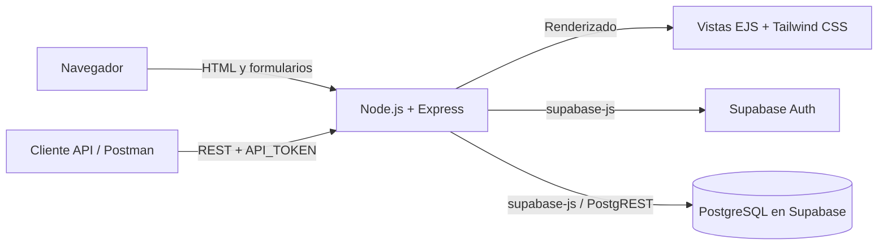

# Barbería PP2 — Sistema de gestión de turnos

Aplicación web para administrar los servicios, el equipo y los turnos de una barbería. Centraliza la información en una base PostgreSQL remota de Supabase y ofrece una interfaz de consulta pública, gestión web de usuarios y una API REST para las operaciones del MVP.

## Arquitectura



La aplicación es renderizada en el servidor: no hay una SPA ni un servicio frontend independiente. El diagrama de datos del proyecto está en [`DATABASE-DIAGRAM.md`](./DATABASE-DIAGRAM.md).

## Tecnologías utilizadas

| Área | Tecnología |
| --- | --- |
| Interfaz web | EJS, HTML, Tailwind CSS vía CDN |
| Backend | Node.js y Express 4 |
| Acceso a datos | `@supabase/supabase-js` y Supabase PostgREST; no se utiliza ORM/ODM |
| Base de datos | PostgreSQL administrado remotamente por Supabase |
| Autenticación | Supabase Auth para el panel de usuarios; cookie `HttpOnly` en el servidor |
| Pruebas | Node.js Test Runner (`node:test`) |
| Herramientas | npm, Git, Postman/Thunder Client y Nodemon |
| Despliegue | No hay proveedor ni configuración de despliegue definidos en el repositorio |

## Requisitos previos

- Node.js 20 o superior. Las dependencias actuales de Supabase requieren Node.js `>=20`.
- npm (incluido con Node.js; se recomienda una versión compatible con Node 20).
- Un proyecto remoto de Supabase con PostgreSQL y Supabase Auth habilitados.
- Acceso al SQL Editor del proyecto de Supabase para instalar el esquema.

No hace falta instalar PostgreSQL localmente. La aplicación se conecta al proyecto remoto configurado en las variables de entorno.

## Instalación y configuración local

### 1. Clonar el repositorio

```bash
git clone https://github.com/guidovarela/ProyectoBarberia_PP2.git
cd ProyectoBarberia_PP2
```

### 2. Configurar la base de datos

En el SQL Editor de Supabase, ejecutar [`supabase/schema.sql`](./supabase/schema.sql). El esquema crea las tablas `users`, `services` y `appointments`, las restricciones para evitar turnos superpuestos y habilita Row Level Security (RLS). No define políticas públicas de RLS: las consultas de la aplicación se realizan desde el servidor.

La conexión de la aplicación se realiza desde el servidor con la clave secreta de Supabase. No exponerla en el navegador ni incluirla en Git.

### 3. Configurar variables de entorno

Crear `.env` en la raíz del repositorio a partir de `.env.example` y completar los valores:

```dotenv
SUPABASE_URL=https://tu-proyecto.supabase.co
SUPABASE_KEY=tu_clave_secreta_de_supabase
SUPABASE_PUBLISHABLE_KEY=tu_clave_publicable_de_supabase
PORT=3000
API_TOKEN=tu_token_largo_y_aleatorio
```

| Variable | Uso |
| --- | --- |
| `SUPABASE_URL` | URL del proyecto Supabase |
| `SUPABASE_KEY` | Clave secreta usada solo por el backend para consultar y modificar la base |
| `SUPABASE_PUBLISHABLE_KEY` | Clave publicable usada por el backend para iniciar sesión con Supabase Auth |
| `PORT` | Puerto HTTP de Express; por defecto, `3000` |
| `API_TOKEN` | Token requerido por todos los endpoints bajo `/api` |

Este proyecto no tiene un `.env` de frontend: las vistas se sirven desde Express y ninguna clave debe incorporarse al código del navegador. No guardar ni subir `.env` al repositorio.

### 4. Instalar dependencias

Desde la raíz del proyecto:

```bash
npm install
```

## Ejecución y pruebas

Iniciar la aplicación en modo desarrollo:

```bash
npm start
```

El script usa Nodemon y levanta Express en `http://localhost:3000` (o en el puerto indicado por `PORT`). No hay un segundo servidor frontend que iniciar.

Ejecutar las pruebas:

```bash
npm test
```

## Endpoints principales

Todos los endpoints REST bajo `/api` requieren el encabezado:

```http
Authorization: Bearer <API_TOKEN>
```

La autenticación web de `/users` es independiente: utiliza Supabase Auth y verifica que el email de la cuenta tenga un perfil con rol `admin` en `public.users`.

| Método | Ruta | Descripción | Autenticación |
| --- | --- | --- | --- |
| GET | `/api/users` | Lista usuarios | `API_TOKEN` |
| POST | `/api/users` | Crea usuario | `API_TOKEN` |
| GET | `/api/users/:id` | Obtiene un usuario | `API_TOKEN` |
| PATCH | `/api/users/:id` | Actualiza datos o rol | `API_TOKEN` |
| DELETE | `/api/users/:id` | Elimina usuario | `API_TOKEN`; puede rechazarse si tiene turnos |
| GET | `/api/services` | Lista servicios | `API_TOKEN` |
| POST | `/api/services` | Crea servicio | `API_TOKEN` |
| GET | `/api/services/:id` | Obtiene un servicio | `API_TOKEN` |
| PATCH | `/api/services/:id` | Actualiza un servicio | `API_TOKEN` |
| DELETE | `/api/services/:id` | Elimina un servicio | `API_TOKEN`; puede rechazarse si tiene turnos |
| GET | `/api/appointments` | Lista turnos con datos relacionados | `API_TOKEN` |
| POST | `/api/appointments` | Reserva un turno | `API_TOKEN` |
| GET | `/users` | Interfaz web de gestión de usuarios / acceso | Supabase Auth para administrar |
| POST | `/users/login` | Inicia sesión de administración | Credenciales de Supabase Auth |
| POST | `/users/logout` | Cierra la sesión web | Cookie de sesión |
| POST | `/users` | Da de alta un usuario desde la interfaz | Sesión de administrador |
| POST | `/users/:id/update` | Modifica datos o rol desde la interfaz | Sesión de administrador |
| POST | `/users/:id/delete` | Da de baja un usuario desde la interfaz | Sesión de administrador |

Los roles válidos son `client`, `staff` y `admin`. Para reservar un turno, enviar `client_id`, `barber_id`, `service_id` y `starts_at` en ISO 8601 con zona horaria. La duración y el precio se toman del servicio activo. Las restricciones de PostgreSQL impiden solapamientos de turnos confirmados o pendientes para el mismo cliente o barbero.

La disponibilidad horaria laboral, las licencias y los bloqueos por inasistencias no están implementados todavía. El esquema actual no modela horarios ni restricciones de *no-show*.

### Administrar usuarios

1. Crear una cuenta en Supabase Auth.
2. Crear en `public.users` un usuario con el mismo email y rol `admin`.
3. Abrir `http://localhost:3000/users` e iniciar sesión con esa cuenta.
4. Desde el panel se pueden crear usuarios, editar datos y roles, y dar de baja usuarios.

El alta desde este panel crea el perfil en `public.users`, pero no crea una cuenta en Supabase Auth. Si ese usuario necesitará iniciar sesión, su cuenta debe crearse también en Supabase Auth. La base de datos impide eliminar usuarios que tengan turnos asociados debido a las referencias configuradas con `ON DELETE RESTRICT`.

## Estructura del proyecto

```text
.
├── app.js                         # Configuración y middleware de Express
├── bin/
│   └── www                        # Inicio del servidor HTTP
├── lib/
│   └── supabase.js                # Clientes de Supabase para base de datos y Auth
├── routes/
│   ├── api.js                     # API REST de usuarios, servicios y turnos
│   ├── index.js                   # Página principal
│   └── users.js                   # Panel web y sesión de administración
├── views/
│   ├── index.ejs                  # Página pública
│   ├── users.ejs                  # Gestión de usuarios
│   └── partials/                  # Elementos compartidos de las vistas
├── public/
│   ├── images/                    # Recursos gráficos
│   ├── javascripts/               # Scripts del navegador
│   └── stylesheets/               # Estilos propios
├── supabase/
│   └── schema.sql                 # Esquema de la base remota
├── postman/                       # Colección de solicitudes de la API
├── test/                          # Pruebas automatizadas
├── .env.example                   # Plantilla de configuración local
└── package.json                  # Dependencias y scripts npm
```

## Decisiones de diseño y buenas prácticas

- **Persistencia remota:** PostgreSQL de Supabase es la fuente de datos. El acceso se hace desde el backend mediante `@supabase/supabase-js`; no hay base local ni ORM.
- **Separación entre API y panel:** `/api` entrega JSON y exige `API_TOKEN`; `/users` sirve formularios HTML y requiere una sesión administrativa de Supabase Auth para operar.
- **Sesión protegida:** el token de acceso de Supabase Auth se guarda en una cookie `HttpOnly`, con `SameSite=Strict` y `Secure` en producción. La clave secreta de la base permanece en el servidor.
- **Validación:** los endpoints REST validan campos, roles, UUID y fechas; el panel web valida los datos de usuario antes de escribir.
- **Errores:** la API devuelve JSON con códigos HTTP apropiados; los conflictos de unicidad y solapamiento se reportan como conflictos y las referencias inválidas se traducen a errores controlados.
- **Integridad y concurrencia:** restricciones de PostgreSQL aseguran emails únicos y evitan solapamientos incluso ante reservas concurrentes. Las relaciones de turnos impiden borrar registros referenciados.
- **Sin herramientas no configuradas:** el repositorio no define linter ni servicio de despliegue. Las verificaciones disponibles son `npm test`.

## Recursos

- [Diagrama de datos](./DATABASE-DIAGRAM.md)
- [Esquema Supabase](./supabase/schema.sql)
- [Colección de Postman](./postman/Barberia%20API.postman_collection.json)
